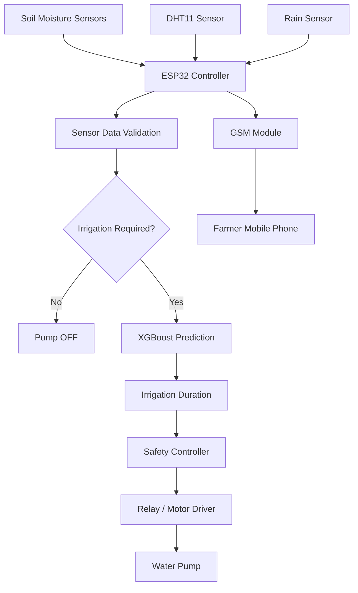

# 🌱 Smart Irrigation System Using ESP32

### IoT-Based Intelligent Irrigation for Smart Agriculture

An IoT and machine-learning-based irrigation project designed to monitor soil and environmental conditions and support efficient water management.

<p align="center">
  
  
  
  
</p>

## 📌 Project Overview

The Smart Irrigation System aims to automate irrigation decisions using an ESP32 microcontroller, multiple sensors and a planned machine-learning pipeline.

The system is designed to monitor soil moisture, temperature, humidity and rainfall. It will use this information to determine whether irrigation is needed and estimate the required watering duration.

Farmer-friendly GSM communication is also planned.

## 🎯 Objectives

- Monitor soil moisture and environmental conditions.
- Reduce unnecessary water consumption.
- Explore machine learning for irrigation decisions.
- Develop a farmer-friendly automated irrigation solution.
- Support remote communication through GSM.

## 🏗️ System Architecture



## 🔧 Planned Hardware Components

| Component | Purpose |
|---|---|
| ESP32 DevKit V1 | Main controller |
| Capacitive soil moisture sensors | Soil moisture monitoring |
| DHT11 | Temperature and humidity |
| Rain sensor | Rain detection |
| SIM800L GSM module | SMS communication |
| Relay / motor driver | Pump switching |
| Water pump | Irrigation |

## 💻 Proposed Technology Stack

| Area | Technology |
|---|---|
| Microcontroller | ESP32 |
| Embedded programming | C/C++ |
| IDE | Arduino IDE |
| Machine Learning | Python, XGBoost |
| Data Processing | Pandas, NumPy |
| Model Evaluation | Scikit-learn |
| Explainable AI | SHAP |
| Communication | GSM / SMS |

## 🤖 Machine Learning Approach

The proposed design uses a two-stage prediction approach.

**Stage 1 — Classification**

An XGBoost classifier will predict whether irrigation is required.

**Stage 2 — Regression**

An XGBoost regressor will estimate irrigation duration when watering is required.

**Explainable AI**

SHAP will be explored to understand the influence of individual sensor features on predictions.

## 📂 Repository Structure

```text
Smart-Irrigation/
│
├── README.md
│
├── docs/
│   └── architecture.md
│
├── hardware/
│   └── components.md
│
├── firmware/
│   └── README.md
│
├── machine-learning/
│   └── README.md
│
├── dataset/
│   └── README.md
│
└── demo/
    └── README.md
```

## 🚀 Planned Development Stages

- [ ] Hardware integration
- [ ] Sensor data acquisition
- [ ] Sensor calibration
- [ ] ESP32 firmware development
- [ ] Dataset collection
- [ ] XGBoost model training
- [ ] SHAP-based model explanation
- [ ] GSM communication
- [ ] Automated pump control
- [ ] Testing and field validation

## 🔮 Future Enhancements

- Tamil SMS notifications.
- Voice-call alerts and IVR.
- Sensor fault detection.
- Edge-based fallback operation.
- Field testing and water-consumption evaluation.

## 📊 Project Status

**Current phase: Design and planning**

The architecture and documentation are being prepared. Hardware integration, firmware development, machine-learning implementation and testing are pending.

Only verified features and experimental results will be marked as completed.

## 👨‍💻 Project Author

**Jayasurya P**

B.E. Computer Science and Engineering – Internet of Things

GitHub: [@Jayasurya2006](https://github.com/Jayasurya2006)

---

*Building an affordable and intelligent irrigation solution for sustainable agriculture.*
