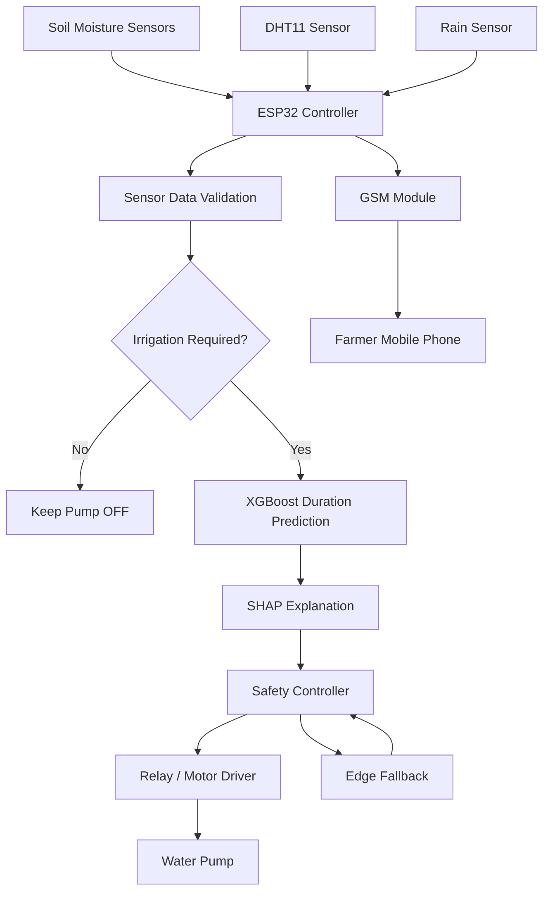

# System Architecture

The following diagram shows the proposed architecture of the Smart Irrigation System.

**Note:** This represents the planned architecture. Individual components will be marked implemented after hardware and software testing.
